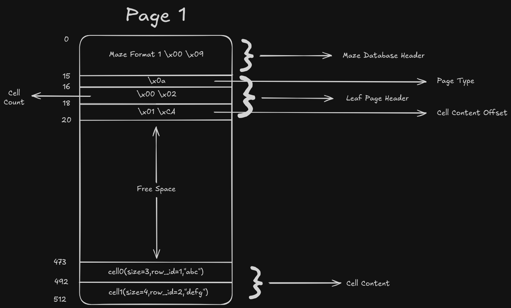

# The Database File
## Pages
- main database file consists of one or more pages
- each page is the same size in the same database file (no variable length pages)
- the page size is determined by a 2-byte integer located at a 16-byte offset from beginning of the file
- the size can be between 512 (2^9) to 65536 (2^16) bytes
- page numbers begin w 1, max being 2^32 - 2.
- min size of sqlite database = 512 bytes (a single 512 byte page)
- max size = (2^32 - 2)(2^16) ~ 281 TB, but host FS max file size limit will be hit first.
- a page can be used either as
    1. b-tree page
        1. a table b-tree interior page
        2. a table b-tree leaf page
        3. an index b-tree interior page
        4. an index b-tree leaf page
    2. freelist page
        1. a freelist trunk page
        2. a freelist leaf page
    3. A payload overflow page
    4. A pointer map page
    5. The lock-byte page

- all reads from and writes to the main database file begin at a page boundary 
    - all writes are an integer number of pages in size
    - reads are also usually an integer number of pages in size, with one exception 
        - when the database is first opened, the first 100 bytes of the database file (the database file header) are read as a sub-page size unit
## The Database Header
- first 100 bytes are the header
- stored in normal big-endian style (MSB to LSB left to right)

| Offset | Size | Description |
| :---:  | :---:| :---        |
| 0 | 14 | Header string "Maze format 2\0" |
| 14 | 1 | Page size $\in$ [9, 16] |
| 15 | 4 | Page number of first freelist trunk page |
| 19 | 4 | Number of free pages |

Database header size = 23B (as of now)

## b-tree Page Cells
- A cell's (interior or leaf page cell) `row_id` can be 0. The first cell's `row_id` must be 0.

# Row Deletion Policy
1. non-root leaf pages are allowed to as little as one cell, its okay.
2. as soon as it loses that single cell, it gets deleted (freed). 
    - similarly a non-root interior page with no children is deleted.
    - root never disappears
3. a non-root interior page may have zero cells (need to make changes in code for this)
4. deleting a missing key returns an error
5. freed pages are leaked for now (next subproject reclaims them in the freelist)

- repacking reclaims inter-page holes in disk, so that is already covered. 

# Freelist policy
1. a newly initialized database starts with freelist page set to 0 (no free page, 1st page is automatically a table leaf page)
2. when a page is freed for the first time, it becomes the new head freelist trunk page.

**Note**: freelist ops are not yet atomic. `get_fp` and `insert_fp` write a freelist trunk page, and then write to header. if in between a crash occurs, state will be inconsistent on the next init (head = none but count > 0, head = some but count == 0 etc).

# Indexing
- indexes are non-unique by default
    - duplicates disambiguated by `row_id`
    - unique enforced via a pre-insert `range_scan` check when `unique = true`
## Cross Value ordering
$\text{Null} \lt \text{(Integer, Real)} \lt \text{Text} \lt \text{Blob}$

## SQL Parsing
- Mixed case SQL keywords are not allowed. Either all low or all caps.
- Data of type `BLOB` must be in hexadecimal format.
- Supported:
    - Statements `CREATE TABLE/INDEX`, `SELECT`, `INSERT`, `UPDATE`, `DELETE`.
    - Clauses `WHERE`, `ORDER  BY`, `LIMIT`. 
- Not supported:
    - No `DROP TABLE` support yet, but this is a TODO.
    - No `JOIN` support yet, but this is a TODO.
    - No `GROUP BY` support yet, but this is a TODO.
    - No aggregate functions like `COUNT()`, `AVG()` etc support yet, but this is a TODO. 
    - Nested SQL queries (subqueries) are not supported yet.
    - TCL, DCL and `ALTER TABLE` commands aren't supported yet.
    - No window functions support.
    - `SELECT` statements without a `FROM` clause is not yet supported.